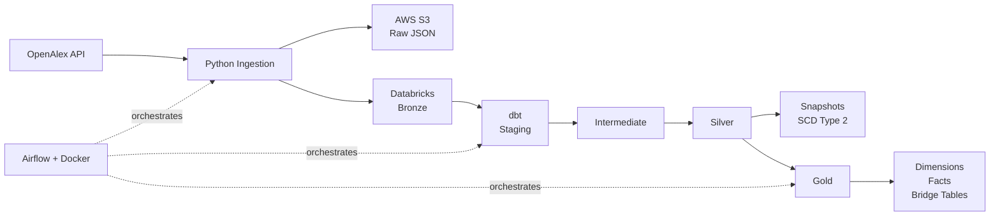
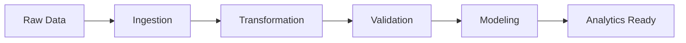

<h1 align="center">Hi, I'm Michał 👋</h1>

<h3 align="center">Data & Analytics Engineering</h3>

  SQL • Python • dbt • Databricks • Airflow • Docker • Delta Lake • Cloud

  I build practical end-to-end data projects that transform raw data into reliable, tested and analytics-ready datasets.

  
  
  

---

## 👨‍💻 About Me

I have a bachelor's degree in **Economics** and am currently pursuing a master's degree while developing my skills in **Data Engineering and Analytics Engineering**.

I focus on building practical data solutions using **Python, SQL, dbt, Databricks, PySpark, and cloud platforms such as Azure and AWS**.

Through personal projects, I work on end-to-end data pipelines, from API ingestion and cloud storage to data transformation, testing, dimensional modeling, and analytics-ready datasets.

I'm particularly interested in **data pipeline development, the Medallion Architecture, incremental processing, data quality, and turning raw data into reliable datasets for analytics and business decision-making**.

---

## 🛠️ Tech Stack

  
  
  
  
  
  
  
  
  
  
  
  
  
  
  
  

## 🚀 Featured Projects

| Project | Stack | Focus |
|:--|:--|:--|
| 🚀 [OpenAlex Data Engineering Pipeline](https://github.com/Gezzus1703/openalex-data-engineering) | Python, AWS S3, Databricks, dbt | Data Pipelines |
| 🌊 [Cloud Lakehouse & ETL Pipeline](https://github.com/Gezzus1703/usgs-hydro-data) | Azure Data Factory, Databricks, PySpark | Cloud Data Engineering |
| ⚡ [E-Commerce Streaming Pipeline](https://github.com/Gezzus1703/ecom-stream-pipeline) | Azure, Databricks, PySpark, Delta Lake | Streaming & Analytics |
| 🏠 [Austin Airbnb Market Analysis](https://github.com/Gezzus1703/austin-airbnb-sql-powerbi-analysis) | SQL Server, Power BI | Market Analysis |
| 🛒 [Olist E-commerce Analysis](https://github.com/Gezzus1703/olist-ecommerce-sql-powerbi-analysis) | PostgreSQL, Power BI | Sales Analytics |
| 📉 [Telco Customer Churn Analysis](https://github.com/Gezzus1703/telco-customer-churn-sql-powerbi-analysis) | PostgreSQL, Power BI | Churn & Revenue Risk |
| 🏨 [Hotel Booking Demand Analysis](https://github.com/Gezzus1703/hotel-booking-demand-excel-analysis) | Excel, Power Query | Booking & Revenue Analysis |
| 📓 [Customer Churn Analysis](https://github.com/Gezzus1703/Customer-Churn-Analysis) | Python, Databricks, PySpark | Data Transformation |

---

## 🚀 Featured Project

### 🔬 [OpenAlex Pipeline](https://github.com/Gezzus1703/openalex-data-engineering)

An end-to-end analytics engineering pipeline built around research publication data from the **OpenAlex REST API**.

### 🏗️ Architecture

### ⭐ Project Highlights

| Ingestion & Storage  | Transformation & Modeling | Quality & Orchestration |
| -------------------- | ------------------------- | ----------------------- |
| REST API ingestion   | Bronze → Silver → Gold    | dbt data tests          |
| API pagination       | Staging models            | Custom SQL tests        |
| Batch IDs            | Intermediate models       | Relationship validation |
| Ingestion timestamps | Incremental models        | Data quality gates      |
| AWS S3 raw JSON      | dbt Snapshots             | Apache Airflow          |
| Databricks Bronze    | SCD Type 2                | Docker Compose          |
| Delta Lake           | Facts & Dimensions        | Service Principal Auth  |
| Nested JSON          | Bridge Tables             | End-to-end execution    |

<b>More about the project</b>

 

The pipeline retrieves research publication data from OpenAlex and stores the raw API responses in AWS S3 while also loading them into a Databricks Bronze layer.

dbt is used to transform the nested source data through staging, intermediate, Silver and Gold layers.

The project includes:

* historical metric tracking
* many-to-many relationship modeling
* incremental fact tables
* dimensional models
* dbt snapshots
* Slowly Changing Dimensions Type 2
* automated data validation
* orchestration through Apache Airflow
* environment-based credential management

  

---

## ⚙️ What I Work With

<table>
<tr>

<td width="33%" valign="top">

### Analytics Engineering

* Python
* SQL
* dbt
* Databricks
* Delta Lake
* Apache Airflow
* Docker

</td>

<td width="33%" valign="top">

### Cloud & Databases

* AWS S3
* Google Cloud Platform
* PostgreSQL
* SQL Server
* DBeaver
* Cloud storage
* Data lakes

</td>

<td width="33%" valign="top">

### BI & Development

* Power BI
* Excel
* Power Query
* Git
* GitHub
* Docker Compose
* uv

</td>

</tr>
</table>

---

## 🧠 Core Data Skills

| Pipelines              | Data Modeling         | Data Quality         |
| ---------------------- | --------------------- | -------------------- |
| ETL / ELT              | Dimensional Modeling  | Not-null testing     |
| REST API ingestion     | Fact tables           | Unique key testing   |
| Batch processing       | Dimension tables      | Relationship testing |
| Nested JSON            | Bridge tables         | Custom SQL tests     |
| Cloud storage          | Many-to-many modeling | Data validation      |
| Medallion architecture | SCD Type 2            | Quality gates        |
| Incremental processing | Historical tracking   | Data integrity       |

---

## 🛠️ What I Can Build

<table>
<tr>

<td width="50%" valign="top">

### 🔄 Data Pipelines

* API ingestion pipelines
* batch-based processing
* raw data storage
* cloud data workflows
* incremental transformations
* multi-layer ELT pipelines

### 🧱 Data Models

* dimensional models
* fact tables
* dimension tables
* bridge tables
* many-to-many relationships
* historical models

</td>

<td width="50%" valign="top">

### 🧪 Data Quality

* dbt tests
* relationship tests
* uniqueness validation
* custom SQL tests
* integrity checks
* pipeline quality gates

### 🎛️ Orchestration

* Apache Airflow DAGs
* task dependencies
* dbt orchestration
* Docker-based environments
* Databricks integration
* end-to-end pipeline execution

</td>

</tr>
</table>

---

## 🔍 How I Approach Data Projects

| Stage              | What I Focus On                                                  |
| ------------------ | ---------------------------------------------------------------- |
| **Ingestion**      | Reliable data retrieval, pagination, metadata and batch tracking |
| **Transformation** | Clean, modular and reusable SQL/dbt models                       |
| **Validation**     | Automated tests and relationship integrity                       |
| **Modeling**       | Clear facts, dimensions and relationships                        |
| **Delivery**       | Reliable datasets prepared for downstream analytics              |

---

## 🌱 Currently Developing

<b>⚙️ Analytics Engineering</b>

 

| dbt                  | Modeling           | Reliability       |
| -------------------- | ------------------ | ----------------- |
| Reusable models      | Dimensional models | Advanced tests    |
| Incremental patterns | Historical models  | Documentation     |
| Project structure    | Data lineage       | Model contracts   |
| Jinja logic          | Semantic design    | Better validation |

<b>🔧 Data Engineering & Cloud</b>

 

| Pipelines                  | Platforms  | Operations     |
| -------------------------- | ---------- | -------------- |
| Production-style pipelines | Databricks | Monitoring     |
| Airflow orchestration      | Delta Lake | Error handling |
| Data lake architecture     | AWS        | Observability  |
| Cloud workflows            | GCP        | Reliability    |

---

## 🎯 Current Focus

  <b>Raw Data → Reliable Pipelines → Tested Models → Analytics-Ready Data</b>

  I'm currently focused on building projects that demonstrate how modern data systems work from ingestion and transformation to reliable analytical models.

---

## 📫 Contact

  
  

  <b>Thanks for visiting my profile 👋</b>

